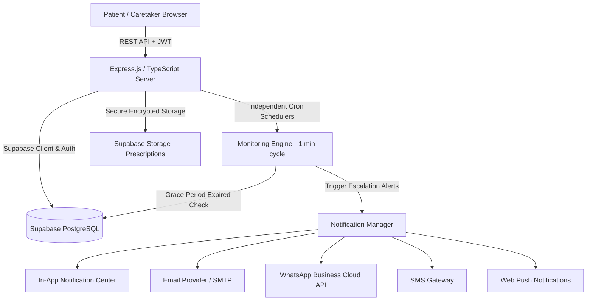

# MediTrack – Smart Medicine Management & Medication Adherence System

MediTrack is an enterprise-grade, comprehensive medication management and adherence monitoring platform. It is engineered specifically for patients who take multiple medications throughout the day and need family members or designated caretakers to proactively monitor whether scheduled medicines have been taken.

> [!IMPORTANT]
> **Independent Backend Scheduling**: The scheduler runs continuously as an independent background process (`node-cron`). Closing the browser or switching off the patient's computer will **never** stop scheduled medication checks, grace period evaluations, or caretaker escalation alerts.

---

## Architecture & Technology Stack



### Stack Details
- **Frontend**: HTML5, Modern CSS3 (CSS Variables, Flexbox, CSS Grid, Light/Dark theme support), Vanilla Modular JavaScript (ES Modules, Component architecture, Hash SPA Router).
- **Backend**: Node.js v24, TypeScript v5, Express.js REST API.
- **Database & Auth**: Supabase PostgreSQL with 16 normalized tables, Foreign Keys, Triggers, and Row-Level Security (RLS) policies.
- **Storage**: Supabase Storage private bucket for prescription documents with temporary signed URLs.
- **Scheduler**: `node-cron` executing 1-minute monitoring cycles and daily dose generation.
- **Notifications**: Multi-channel provider adapter architecture (In-App, Email/Nodemailer, WhatsApp Business Cloud API, SMS, Web Push). Supports automatic simulation fallback in test mode for unconfigured channels.
- **Reporting**: Automated PDF generation (`pdfkit`) and CSV export.

---

## 16 Database Tables Overview

| Table | Description |
|---|---|
| `profiles` | Extends auth.users with role (`patient`, `caretaker`, `admin`), timezone, emergency contact. |
| `doctors` | Prescribing physicians and clinic directory. |
| `medicines` | Complete medicine inventory master with dosage, intake units, food timing, status. |
| `medication_schedules` | Daily intake times, dosage quantities, days of week, grace periods. |
| `scheduled_doses` | Daily generated dose instances with unique constraint `(schedule_id, scheduled_date)` for idempotency. |
| `medication_logs` | Comprehensive audit trail of dose actions (marked taken, skipped, corrected). |
| `patient_caretaker_relationships` | Caretaker authorizations, invitation tokens, status (`pending`, `accepted`, `revoked`). |
| `caretaker_permissions` | Granular permission settings (primary/secondary, overdue alerts, stock alerts, edit permissions). |
| `prescriptions` | Uploaded prescription metadata, private storage paths, OCR text suggestions. |
| `prescription_revisions` | Revision tracking when prescriptions are updated by doctors. |
| `medicine_inventory` | Available stock balance, unit name, low-stock threshold, refill dates. |
| `inventory_transactions` | Safe stock transaction log with unique idempotency keys preventing duplicate deductions. |
| `notifications` | Central notification queue with severity levels (`info`, `warning`, `critical`). |
| `notification_preferences` | User-configurable notification channels and quiet hours. |
| `notification_delivery_logs` | Delivery attempts, timestamps, provider responses, and error logs. |
| `audit_logs` | System-wide audit log for all critical entities. |

---

## Automated Reminder & Overdue Escalation Workflow

```
[ Scheduled Time (e.g. 08:00 AM) ]
       │
       ▼
   Initial Reminder Sent to Patient (In-app, Push, Email)
       │
       ▼ (15 mins elapsed, still unconfirmed)
   Follow-Up Reminder Sent to Patient
       │
       ▼ (Grace Period Expires, e.g. 08:30 AM)
   Dose Status Transitioned to 'OVERDUE'
       │
       ▼
   URGENT Caretaker Alert Dispatched to Authorized Caretakers
   (WhatsApp, SMS, Email, In-app)
       │
       ▼ (Patient confirms dose late)
   Status Updated to 'TAKEN', Inventory Deducted (Once)
       │
       ▼
   Follow-up Late Confirmation Update Dispatched to Caretakers
```

---

## Getting Started

### 1. Database Initialization (One-time)
1. Open your Supabase Project SQL Editor:
   **[https://supabase.com/dashboard/project/zadepztpubocvhjivlvj/sql](https://supabase.com/dashboard/project/zadepztpubocvhjivlvj/sql)**
2. Click **"New query"**.
3. Copy the entire contents of [`backend/migrations/001_initial_schema.sql`](file:///c:/Users/bhavy/OneDrive/Desktop/Projects/Medicine%20Management/backend/migrations/001_initial_schema.sql) and paste it into the editor.
4. Click **Run**. All 16 tables, triggers, and RLS policies will be created instantly.

### 2. Seeding Accounts & Medication List Policy
> [!IMPORTANT]
> **Zero-Medication Default Policy**: In production, new patient accounts start with an **empty** medication list. MediTrack never pre-populates or automatically recommends any medical prescription. All medicines, schedules, and dosages must be entered manually by the patient or authorized caretaker strictly according to a licensed physician's prescription.

For development and evaluation, two seeding modes are provided:

**Option A: Clean Slate (Empty Medicine List - Recommended)**
```bash
cd backend
npm run seed -- --empty
```
This registers the demo accounts with zero medicines, letting you test the physician prescription entry flow from scratch:
- **Demo Patient**: `patient@meditrack.local` / `Password@123`
- **Demo Caretaker**: `caretaker@meditrack.local` / `Password@123`

To reset an existing patient account back to 0 medicines at any time:
```bash
npm run clean-slate
```

**Option B: Fictional Demo Medicines (Development Only)**
```bash
npm run seed
```
This seeds clearly labeled fictional sample entries (e.g. `[DEMO] Sample Tablet Alpha`, `[DEMO] Sample Capsule Beta`) for UI testing.

### 3. Running Automated Verification Tests
Run the complete automated test suite verifying all 6 scheduler scenarios, 9 end-to-end integration flows, and 35 User Acceptance Tests (UAT):
```bash
cd backend
npm test
```
Or run the individual suites:
- Comprehensive User Acceptance Test (UAT) Suite (All 35 verification tests):
  ```bash
  npm run test:uat
  ```
- Scheduler & Overdue Escalation Suite (Scenarios A through F):
  ```bash
  npm run test:scheduler
  ```
- End-to-End Integration, Auth, CRUD, Caretaker, & RLS Suite (Tests 1 through 9):
  ```bash
  npm run test:e2e
  ```

### 4. Start the Server
```bash
cd backend
npm run dev
```
Open your browser at **`http://localhost:5000`**.

---

## Acceptance Criteria Verification Matrix

| # | Criteria | Implementation Status |
|---|---|---|
| 1 | Register patient & log in | ✓ Implemented via Supabase Auth & JWT session |
| 2 | Add new medicine | ✓ Full CRUD in `medicineService.ts` & UI Modal |
| 3 | Edit & discontinue medicine | ✓ Preserves historical records, disables future doses |
| 4 | Multiple daily schedules | ✓ Supports multiple times (e.g. 08:00, 20:00) |
| 5 | Generate daily dose records | ✓ Idempotent dose generation via unique constraint |
| 6 | Mark dose as taken | ✓ Real-time update, records confirmation timestamp |
| 7 | Dashboard updates immediately | ✓ Real-time DOM updates & adherence progress bar |
| 8 | Inventory deducted exactly once | ✓ Idempotency key `dose_deduction_{id}` |
| 9 | Dose passes grace period | ✓ Background scheduler detects expired grace period |
| 10 | Patient receives reminders | ✓ Initial (0m) and follow-up (15m) reminders |
| 11 | Caretaker receives overdue alert | ✓ Dispatched to authorized primary/secondary caretakers |
| 12 | Late confirmation updates caretaker | ✓ Automatic follow-up alert sent upon late confirmation |
| 13 | Secure prescription upload & retrieve | ✓ Private bucket storage + temporary signed URLs |
| 14 | Add multiple authorized caretakers | ✓ Granular permission levels & custom channels |
| 15 | Revoke caretaker access | ✓ Immediate access termination via relationship status |
| 16 | Daily, weekly, monthly analytics | ✓ Full adherence calculation engine |
| 17 | Calendar & historical records | ✓ Monthly interactive calendar with color-coded status |
| 18 | Low-stock notifications | ✓ Auto-triggered when stock hits threshold |
| 19 | PDF and CSV exports | ✓ Streaming PDF (`pdfkit`) and CSV export routes |
| 20 | Historical records immutable on schedule change | ✓ Historical doses preserved in separate table |
| 21 | Notification retries & failure logs | ✓ Recorded in `notification_delivery_logs` |
| 22 | Scheduler restart handling | ✓ Re-runs checks safely on server reboot |
| 23 | Timezone handling | ✓ Default `Asia/Kolkata` with UTC database storage |
| 24 | Row Level Security | ✓ 16 tables secured with RLS policies |

